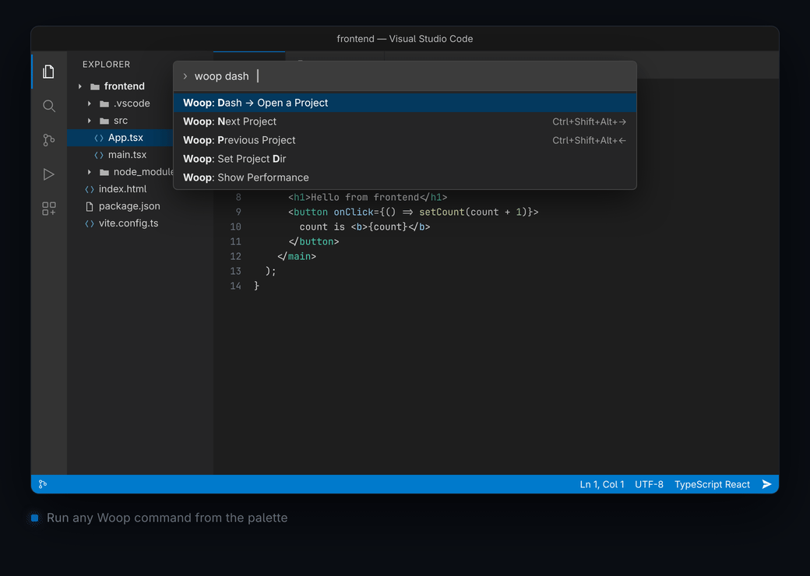

<div align="center">


# Woop

**Your projects, one keystroke away.**

Launch, switch, and run any project without leaving VS Code.

[](https://marketplace.visualstudio.com/items?itemName=chattkush.woop)
[](https://marketplace.visualstudio.com/items?itemName=chattkush.woop)
[](https://marketplace.visualstudio.com/items?itemName=chattkush.woop)
[](https://github.com/kush34/woop/actions/workflows/publish.yml)

[Install](#install) · [Features](#features) · [Quick Start](#quick-start) · [Commands](#commands) · [Stacks](#auto-detected-stacks) · [Development](#development) · [Changelog](CHANGELOG.md)

</div>

<br>

<p align="center">
  
</p>

<br>

## Why Woop?

Most project switchers make you leave the editor. Woop keeps **everything in the status bar** — no side panels, no new windows, no context switching.

| | |
|---|---|
| ⚡ **Instant project switching** | Jump between repos from a searchable picker — no terminal, no file manager |
| 🎯 **Status bar commands** | Pin `npm run dev`, `cargo run`, or any shell command right where your eyes already are |
| 🔍 **Zero-config detection** | Woop scans for `package.json`, `Cargo.toml`, `go.mod`, and more — then suggests the right commands |
| 🟢 **Live state at a glance** | See which servers are running, idle, or crashed without switching tabs |

---

## Install

**From the Marketplace**

Search **"Woop"** in the VS Code Extensions view, or run:

```bash
code --install-extension chattkush.woop
```

> **Requires** VS Code **1.107** or newer.

**From source**

```bash
git clone https://github.com/kush34/woop.git
cd woop
pnpm install
pnpm run compile
# Press F5 to launch the Extension Development Host
```

---

## Features

### Project Switcher

Open any project from a searchable picker, grouped by root folder. Projects are discovered automatically — just point Woop at the parent directories where your repos live.

- **Cycle projects** with <kbd>Ctrl</kbd>+<kbd>Shift</kbd>+<kbd>Alt</kbd>+<kbd>→</kbd> / <kbd>←</kbd>
- **Refresh** the picker to re-index after adding new projects
- **Instant display** — the picker appears immediately and fills in the background

### Status Bar Commands

Pin any shell command to the status bar. Click to run, click to stop, click to restart.

| Icon | State | Click action |
|:---:|---|---|
| `$(terminal)` | **Idle** | Run command |
| `$(stop-circle)` | **Running** | Stop (`Ctrl+C`) |
| `$(warning)` | **Errored** | Restart |

### Auto-Detection

When you open a project, Woop scans for known config files and suggests the right commands. Works in the workspace root and common service folders (`backend/`, `frontend/`, `api/`, `server/`, and more).

### Performance Built In

- Dash opens before any I/O starts — scans run in parallel
- Directory listings are cached per session
- Run `pnpm run bench` to measure performance against the previous commit

---

## Quick Start

**1. Add your projects folder**

<kbd>Ctrl</kbd>+<kbd>Shift</kbd>+<kbd>P</kbd> → **Woop: Set Project Dir** → paste the path to your projects folder. Repeat for as many roots as you like.

**2. Open the dash**

<kbd>Ctrl</kbd>+<kbd>Shift</kbd>+<kbd>P</kbd> → **Woop: Dash → Open a Project** → pick a project and press <kbd>Enter</kbd>.

**3. Pin your run commands**

When you open a project, Woop offers to auto-detect commands. Choose **Auto-detect**, pick what you want, and each command appears in the status bar.

> **Manual setup:** Click `$(send)` in the status bar → **Add Command (manual)** → enter a label, the command, and the working directory.

**4. Work from the status bar**

Click a command to run it. Click again to stop. After a crash, click to restart. That's it.

---

## Commands

| Command | Description |
|---|---|
| `woop.dash` | Open the project picker |
| `woop.nextProject` | Switch to the next project |
| `woop.prevProject` | Switch to the previous project |
| `woop.setDash` | Add a projects root by path |
| `woop.dashGUI` | Add a projects root with the folder picker |
| `woop.removeProjectDir` | Remove a projects root |
| `woop.view` | Show all configured roots |
| `woop.setCmd` | Add a status bar command manually |
| `woop.perf` | Show in-memory performance timings |

### Keybindings

| Action | Shortcut |
|---|---|
| Next project | <kbd>Ctrl</kbd>+<kbd>Shift</kbd>+<kbd>Alt</kbd>+<kbd>→</kbd> |
| Previous project | <kbd>Ctrl</kbd>+<kbd>Shift</kbd>+<kbd>Alt</kbd>+<kbd>←</kbd> |

---

## Auto-Detected Stacks

Woop looks for config files in the workspace root and in common service folders (`backend`, `frontend`, `client`, `server`, `api`, `web`, `app`, `services`, `worker`).

| Stack | Detected by | Suggested command |
|---|---|---|
| **Node / npm** | `package.json` | `npm run dev` · `npm start` · `npm run serve` |
| **Django** | `manage.py` | `python manage.py runserver` |
| **Python** | `main.py` | `python main.py` |
| **Flask** | `app.py` | `python app.py` |
| **FastAPI** | `uvicorn.toml` / `pyproject.toml` | `uvicorn main:app --reload` |
| **Go** | `go.mod` | `go run .` |
| **Rust** | `Cargo.toml` | `cargo run` |
| **Spring Boot** | `pom.xml` | `mvn spring-boot:run` |
| **Gradle** | `build.gradle` / `.kts` | `./gradlew bootRun` |
| **Rails** | `Gemfile` | `bundle exec rails server` |
| **Laravel** | `artisan` | `php artisan serve` |
| **Docker** | `docker-compose.yml` / `.yaml` | `docker-compose up` |

---

## Development

```bash
pnpm install          # install dependencies
pnpm run compile      # type-check & build
pnpm run watch        # rebuild on change
pnpm test             # compile, lint, and run tests
pnpm run bench        # benchmark HEAD vs working tree
pnpm run smoke        # smoke-test every command
```

Press <kbd>F5</kbd> to launch the Extension Development Host.

<details>
<summary><strong>Project structure</strong></summary>

```
src/
  extension.ts     # commands, status bar, detection rules, terminal tracking
  perf.ts          # in-memory timing marks behind woop.perf
bench/             # benchmark and smoke-test harness
public/            # logo and demo assets
```

</details>

### How It Works

- **Storage** — Project roots and pinned commands live in VS Code's `globalState`, following you across workspaces.
- **Dash** — Lists directories one level deep under each root. Scans run in parallel; the picker appears before any I/O starts.
- **Commands** — Each command runs in a named terminal. State (running / idle / errored) is tracked automatically and reflected in the status bar.

---

## Troubleshooting

<details>
<summary><strong>No commands in the status bar</strong></summary>

Run **Woop: Set Cmd for the current Project** or use **Woop Menu → Auto-detect Commands**.

</details>

<details>
<summary><strong>A project doesn't show up in the dash</strong></summary>

It must be a direct subfolder of a configured root. Hit the refresh icon if you added it after the picker was opened.

</details>

<details>
<summary><strong>Stopped server still shows as running</strong></summary>

Woop infers state from the terminal. If you kill the process externally, click the status bar item to stop it, then click again to start.

</details>

<details>
<summary><strong>Command can't find its directory</strong></summary>

Use an absolute path when adding a command manually, or `/` to run in the current workspace folder.

</details>

---

## Contributing

Issues and pull requests are welcome! Please keep changes small and run `pnpm test` before opening a PR.

See [CHANGELOG.md](CHANGELOG.md) for what shipped in each release.

---

<div align="center">

Made for people who switch projects too often. ⚡

</div>
